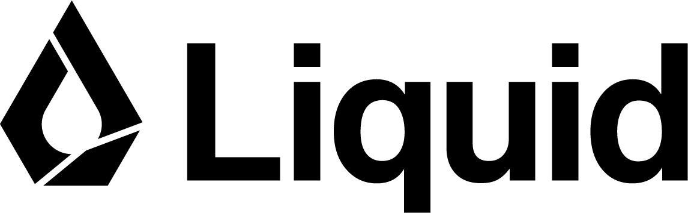

<p align="center">
  
</p>

# 👾 Discord moderation bot with `d1-ultra`

Build a Discord bot that asks one question: **is this message unsolicited solicitation?**

It reads new messages in selected text channels of one server and detects sales,
recruitment, or signup pitches. It saves a report in a private moderator channel,
then deletes eligible text messages with a solicitation score of at least `0.80`.
Below `0.80`, it takes no action.

```text
Message → d1-ultra → below 0.80: no action
                  → 0.80 or above: archive first, then delete eligible text messages
```

**Just want to try d1-ultra?** Open the [notebook](notebooks/d1_ultra_solicitation.ipynb).
It walks through the API independently of Discord.

[](https://colab.research.google.com/github/Liquid4All/d1-discord-mod-tutorial/blob/main/notebooks/d1_ultra_solicitation.ipynb)

## 1. Create a virtual environment

You need Python 3.11+, a [Liquid API](https://console.liquid.ai/) key,
and a Discord server where you have "Manage Server" permission.

Get the code and enter its folder:

```sh
git clone https://github.com/Liquid4All/d1-discord-mod-tutorial.git
cd d1-discord-mod-tutorial
```

Create a local `.venv` once, then activate it. This keeps the project's Python
packages separate from your other projects.

**macOS / Linux:**

```sh
python3 -m venv .venv
source .venv/bin/activate
```

**Windows PowerShell:**

```powershell
py -3 -m venv .venv
.venv\Scripts\Activate.ps1
```

Install the dependencies into the active environment:

```sh
python -m pip install -r requirements.txt
```

When you open a new terminal, return to this folder and run the activation command
again. You only need to create the environment once. Run `deactivate` when finished.

Copy `.env.example` to a new file named `.env` for your keys and settings.
`.venv` holds installed packages; `.env` holds configuration. Both are ignored by
Git. Leave the example file empty.

## 2. Get your API key and bot token

**Liquid:** open [Liquid Console](https://console.liquid.ai), select your
organization, then go to **Dashboard → API Keys** and create a key.

**Discord:** open the [Developer Portal](https://discord.com/developers/applications):

1. Create a **New Application** named `d1-mod-tutorial`.
2. Open **Bot → Reset Token** and copy the token.
3. Enable **Message Content Intent** on the Bot page and save.
4. Under **Installation**, enable **Guild Install**, select **Discord Provided
   Link**, and add the **bot** scope to the Guild Install defaults.
5. Select **View Channels**, **Read Message History**, **Manage Messages**,
   **Send Messages**, **Embed Links**, and **Attach Files** permissions.
6. Open the install link, choose **Add to server**, and select your test server.

## 3. Choose the channels to monitor

Choose one or more text channels to monitor, such as `#general`.
Create a **private** `#mod-review` text channel in the same server. Give the bot
**View Channel**, **Read Message History**, and **Manage Messages** in each monitored
channel. In `#mod-review`, give it **View Channel**, **Send Messages**, **Embed Links**,
and **Attach Files**. This channel holds archives for post-mortem analysis; keep it
visible only to moderators and the bot.

In Discord, enable **User Settings → Developer → Developer Mode**. Right-click
each channel and choose **Copy Channel ID**. Fill in your local `.env`:

```dotenv
LIQUID_API_KEY=your_liquid_key_here
DISCORD_BOT_TOKEN=your_discord_bot_token_here
DISCORD_CHANNEL_IDS=111111111111111111,222222222222222222
DISCORD_REVIEW_CHANNEL_ID=your_private_mod_review_channel_id
```

Replace the example numbers with your monitored channels' IDs, separated by commas.
Use one numeric ID for the private review channel and keep it out of that list.
All channels must be in the same server; the bot checks this at startup.

## 4. Understand the decision

[classifier.py](classifier.py) uses `TypeSafeClient` and `Noul`, following
[Liquid's Python SDK example](https://docs.liquid.ai/lfm/models/d1#setup):

```python
from typesafe_sdk import Noul, TypeSafeClient

with TypeSafeClient(
    api_key=api_key,
    base_url="https://api.liquid.ai/decisions",
    compression=False,
) as client:
    result = client.system_one(
        model="d1-ultra",
        state=message,
        questions={"solicitation": Noul(instructions=INSTRUCTIONS)},
    )

probability = result.answers["solicitation"].noul
```

`state` is the message text. `INSTRUCTIONS` explains what counts as solicitation.
`Noul` asks a yes/no question; `.noul` reads the probability of yes.
The pinned SDK appends `/v1/systemone`, so the base URL includes `/decisions` to
reach Liquid's documented endpoint. `compression=False` sends ordinary JSON.
The bot also sets a timeout and disables retries to make one attempt per message.

[bot.py](bot.py) uses one threshold from `classifier.py`:

```python
DELETE_THRESHOLD = 0.80  # Archive in the private channel, then delete.
```

This threshold is a starting point. Feel free to adjust it based on your own data
and moderation preferences. Test your chosen value on representative messages
before enabling automatic deletion.

## 5. Run it

With your virtual environment active:

```sh
python bot.py
```

Wait for `Ready: watching ...; reports go to #mod-review`, listing your selected
channels. Then post these invented examples in a monitored test channel from
your own account, one at a time:

| Message | Desired result |
|---|---|
| Buy my AI consulting package. DM me for pricing. | Archive and delete if score ≥ 0.80 |
| Join my business opportunity. DM to earn money. | Archive and delete if score ≥ 0.80 |
| I built an open-source chatbot. Feedback is welcome. | No action |
| How do I run this model locally? | No action |
| Watch out for “DM me to earn money” messages — it's a scam. | No action |


Keep the program running while testing. Press **Ctrl+C** to stop. Restart after
changing settings or code.


## Scope

This repo is a minimal starting point for building your own Discord moderation bot
with `d1-ultra`. It demonstrates one policy: detecting unsolicited solicitation,
then archiving and deleting eligible text messages that meet your chosen threshold.

The bot checks new text messages in selected channels while the program is running.
It skips messages with attachments and does not process message edits. It handles
one message at a time, skips new messages while busy, and logs failed API requests
without retrying them.

Possible next steps include:

- **Continuous monitoring:** deploy the bot on a cloud server and configure it to
  restart automatically after a crash or reboot.
- **Observability and evaluation:** store decisions, scores, errors, and moderator
  feedback in a database. Use those records to build evaluation datasets and refine
  the policy instructions and deletion threshold.
- **Image moderation:** extend the bot to check attached images with `d1-ultra`,
  which supports [image inputs](https://docs.liquid.ai/lfm/models/d1#image-inputs).
- **Reliability and customization:** add a message queue and retries for temporary
  API failures, or expand the bot with moderation policies tailored to your server.

## Support

- 📖 [Liquid AI Documentation](https://docs.liquid.ai/)
- 💬 [Join our community on Discord](https://discord.com/invite/liquid-ai)
